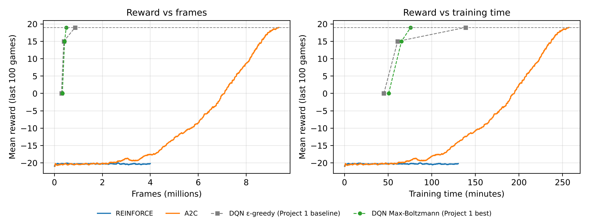

# CMPE 260 Project 2: Policy Gradients on Atari Pong

Team: Jaya Vyas, Prachi Gupta, Keerthana Muralidharan, Yashaswini Dinesh
Instructor: Jahan Ghofraniha, San Jose State University

We trained two policy-gradient agents on Atari Pong, REINFORCE (the baseline) and A2C (advantage actor-critic),
and compared them with the DQN from our [Project 1 repository](https://github.com/jayavyas0701/reinforcementLearning-project1-dqn-pong).
Everything except the learning algorithm is the same as Project 1:

- the `PongNoFrameskip-v4` environment and wrappers (4-frame skip, 84×84 grayscale, 4 stacked frames)
- the conv network, γ = 0.99, and the definition of convergence (mean reward of the last 100 games, `reward_100`, reaches 19)
- the GPU type, a Google Colab Tesla T4, so training minutes compare directly across the two projects

## Results

| Metric | REINFORCE | A2C | DQN (Project 1) |
|---|---|---|---|
| Frames to reward_100 = 19 | not reached in 4M | 9.36M | 0.49M–0.86M |
| Minutes to 19 | not reached (130 min trained) | 257.3 | 75.8–138.8 |
| Best reward_100 | −19.97 | 19.00 | 19.01–19.36 |
| Frames per second | 511 | 607 | ~105 |
| Gradient updates | 1,079 | 73,149 | ~0.48M–1.7M |
| Times each sample is used | 1 | 1 | ~32 |
| Value bias (estimate − real return) | none (uses real returns) | +0.07 | +0.61 |
| Test games (3) | −21, −18, −21 | 21, 16, 19 | 21, 21, 21 |

The DQN range covers our two Project 1 runs: Max-Boltzmann (best) and ε-greedy (baseline), both with a 10k buffer.
DQN's bias was measured on the saved Project 1 Max-Boltzmann model.



Main findings:

1. **REINFORCE stayed at about −20.** Seven settings (baseline, per-point returns, entropy bonus, three learning
   rates, 16 games per update) all ended between −20.19 and −20.41 after 500k frames. A gradient-noise test explains
   why: gradients from different batches of games agree almost not at all (average cosine similarity between −0.08 and
   +0.01), so every update is close to a random step.
2. **A2C learned Pong.** The critic gives feedback every 4 steps instead of once per game. A2C made 29× more updates
   per frame than REINFORCE and reached 19 at 9.36M frames. At an equal 4M-frame budget the textbook settings
   (lr 1e-3, gradient clip 0.1) beat a higher learning rate and a looser clip.
3. **DQN needs 10–19× fewer frames than A2C.** DQN is off-policy and replays each frame about 32 times; REINFORCE and
   A2C are on-policy and use each frame once. DQN's max over noisy Q-values over-estimates by +0.61; A2C's critic has
   no max and is off by only +0.07.

The full write-up is in the Project 2 report.

## How to run

**Colab (how the results were produced).** Open `notebooks/CMPE260_Project2_PG.ipynb` in Colab with a GPU runtime and
run the cells from top to bottom. Every run saves to `MyDrive/CMPE260_Project2/runs` and writes a checkpoint every 10
minutes. If Colab disconnects, run the setup cells again and re-run the same training cell; it continues where it
stopped. A training cell whose run has already finished just loads it, so re-running the notebook is safe.
Section 11 needs the Project 1 model; set `DQN_MODEL_PATH` to `PongNoFrameskip-v4-maxboltz-best.dat` from the Project 1 repository.

**Scripts.** The same code is also in `pg_pong/` with command-line scripts:

```bash
pip install -r requirements.txt
python train_reinforce.py --run R2_baseline      # one tuning case (R1_vanilla ... R7_lr_1e-3), 500k frames
python train_reinforce.py --run final            # R2 settings continued to 4M frames
python train_a2c.py --run A1_textbook            # A1_textbook, A2_lr_2e-3, A3_clip_0.5 (2M frames)
python train_a2c.py --run final                  # textbook settings until reward_100 >= 19
python gradient_noise.py                         # REINFORCE gradient-noise test (128 games)
python evaluate.py --dqn-model PongNoFrameskip-v4-maxboltz-best.dat   # test games and value bias
python make_figures.py runs results/figures      # rebuild the report figures from runs/*/episodes.csv
```

Add `--max-frames 20000` to any training script for a quick test. Rough times on a Colab T4: a REINFORCE tuning run
takes about 16 minutes, an A2C tuning run about 55 minutes per 2M frames, and the final A2C run about 4.3 hours.

## Folder layout

| Path | Contents |
|---|---|
| `notebooks/CMPE260_Project2_PG.ipynb` | The notebook that produced every result, with its outputs |
| `pg_pong/` | The notebook code as modules: wrappers (unchanged from Project 1), networks, `RunLogger`, REINFORCE, A2C, analysis |
| `train_reinforce.py`, `train_a2c.py` | Training with the exact tuning and final settings used in the notebook |
| `gradient_noise.py`, `evaluate.py` | The gradient-noise test (notebook 8b) and test games with value bias (notebook 11) |
| `make_figures.py` | Rebuilds the report figures from the saved logs |
| `results/` | Comparison table, tuning tables, gradient-noise table, A2C milestones, and figures |
| `runs/` | Every run: `config.json`, `episodes.csv` (one row per game) and TensorBoard logs; trained models for the two final runs |

`runs/reinforce_final` continues `runs/reinforce_tuning/R2_baseline`, and `runs/a2c_final` continues
`runs/a2c_tuning/A1_textbook`, so their TensorBoard folders also contain the tuning-run logs. The resume checkpoints
and the tuning-run models are left out to keep the repository small.

## References

- Williams, R. J. (1992). Simple statistical gradient-following algorithms for connectionist reinforcement learning. *Machine Learning, 8*, 229–256.
- Mnih, V., et al. (2016). Asynchronous methods for deep reinforcement learning. *ICML 2016*.
- Mnih, V., et al. (2015). Human-level control through deep reinforcement learning. *Nature, 518*, 529–533.
- Lapan, M. (2018). *Deep Reinforcement Learning Hands-On*. Packt (Chapters 9 and 10).
- Karpathy, A. (2016). Deep reinforcement learning: Pong from pixels. http://karpathy.github.io/2016/05/31/rl/
- van Hasselt, H., Guez, A., & Silver, D. (2016). Deep reinforcement learning with double Q-learning. *AAAI 2016*.
